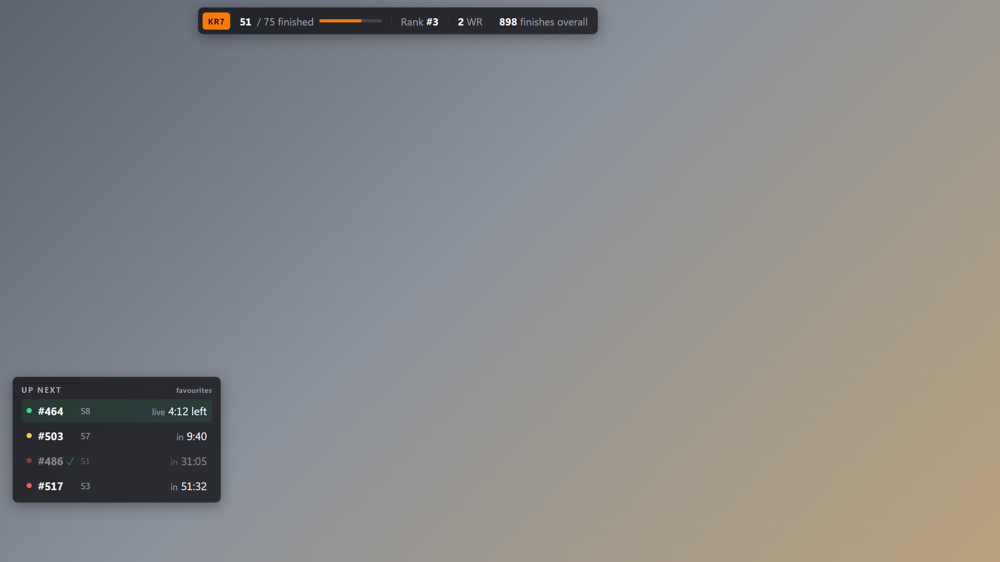
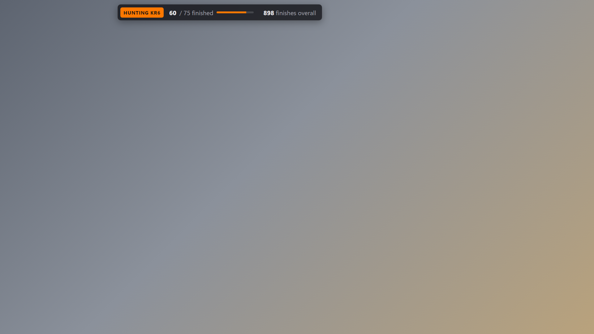
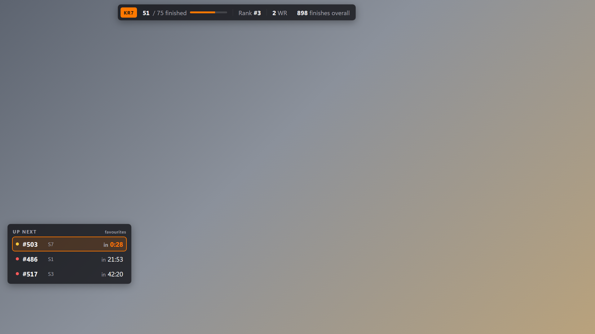
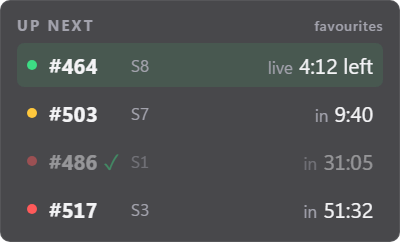
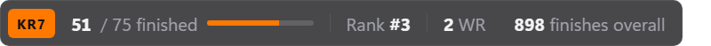
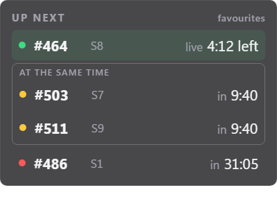

# Streamer Overlay Spec

Status: **Proposal** for [#1](https://github.com/kacky-code/kacky-live/issues/1). Replaces the original
five-widget wireframe.

Checked against the production API and KackyGG `dev` on 2026-11-07, during the live phase of
Kacky Reloaded 7 (event `26`).

## 1. Context & Surface

- **Target surface:** OBS browser source, `1920x1080`, transparent background. Later the same data
  feeds a Twitch panel (Phase 2).
- **Audience:** Viewers of one streamer. The overlay answers what chat asks most: *when is the
  streamer's map up?* and *how far are they?*
- **Not in scope:** Current map, top 5 records, linked servers and donors. Kontrol already shows
  them in game, next to where this overlay would sit.

### Why favourites drive it

A streamer focuses on a handful of maps at a time. With 25 maps left, a list of every unfinished
map is noise. Competitive players pick a rotation of maps they like and whose slots line up, and
mark them as favourites in game (Kontrol). Maps they are not currently trying usually stay
unmarked, so the favourites *are* the rotation.

Kontrol stores a marker type with each favourite (`generic`, `easy`, `medium`, `hard`,
`impossible`), but streamers use them loosely: some only use `generic`, others use a marker for
"luck maps" or a heart for maps they like. The type says nothing reliable about difficulty, so the
overlay shows **every** favourite and never filters by type. The streamer configures nothing
beyond marking maps in game.

### Event phases

| Phase | Example | Overlay |
|---|---|---|
| Live edition | KR7, `id 26`, type `KR` | Stats + up next |
| Hunting | `id 99`, type `KRHX` | Stats only, for the edition being hunted (proposal, see 2). Hunting servers play by vote, so there is no schedule. |
| Between events | – | Overall stats only, or hidden |

The overlay never assumes a server count (it changes during an edition, e.g. 15 early, 10 later).

### Placement

There is no layout that fits every streamer. Some have their camera top right, some top left;
some keep chat on the left, some on the right; some moved Kontrol's HUD, some did not. So the
overlay does not pick a layout. Each widget has its own URL (`?widget=schedule`,
`?widget=progress`, see 4) and becomes its own browser source, which the streamer positions and
scales in OBS on its own. Widgets are designed to look right at 1080p.

Without `widget`, the page shows both widgets on one transparent `1920x1080` layer, for streamers
happy with the default layout.

Why not one URL and OBS cropping: OBS can show the same browser source twice, each copy cropped
to one widget (*Add → Existing*, then crop with Alt+drag). But the widgets change size (the strip
is shorter in hunting, the list follows the number of favourites), so a crop either cuts content
or needs slack, and few streamers know the feature. One URL per widget is what streamers already
do for alerts and chat.

## 2. Widgets

### Up next

The streamer's favourite maps on the live edition servers, soonest first, at most `count`.

```text
+------------------------------+
| UP NEXT                      |
| #464  S8   live · 4:12 left  |
| #503  S7   in 9:40           |
| #486  S1   in 31:05          |
+------------------------------+
```

- One row per map: map number, server tag, state and time.
- States: **live** (time left), **next** on its server, **later** (time until start).
- A row without a time shows `next` or `3 maps away`. That happens when the server's timing is
  unknown or stale: KackyGG gives no forecast rather than a wrong one (see 3.2).
- **Finished favourites** stay listed but dimmed, with a ✓. Players usually unfav a map once they
  finish it (Kontrol has `/unfav finished`), so a finished favourite stays visible until the
  streamer removes it.
- **Favourites at the same time** are boxed together under "at the same time" (proposal, see Open
  Questions). Servers in one sync group switch maps at the same moment, so two favourites on two
  servers of a group often start together. Two rows count as the same time when their `startsAt`
  (or, for live maps, `endsAt`) differ by less than 60 s.
- No favourite on any server → widget hidden.

### Stats strip

```text
KR7 · 51 / 75 finished · rank #3 · 2 WR        898 finishes overall
```

- Event finishes, map count, event rank, world records, overall finishes.
- Between events, only overall finishes.

**Hunting (proposal):** When the streamer grinds a map from an older edition, show their
finishes in that edition next to the overall total:

```text
Hunting KR6 · 60 / 75 finished                 898 finishes overall
```

- Finishes in the edition: `GET /players/{id}/records?eventId={edition id}` (rows with
  `isFinished`); KR6 is event `11`.
- The edition comes from the map number: each edition covers a fixed range (KR6 `#376–#450`,
  KR7 `#451–#525`), listed by `GET /maps?eventId={id}`.
- The current map comes from the server the streamer is on: `serverLogin` on `GET /players/{id}`,
  then that server's `currentMap` in `GET /servers/live`. KackyGG sets `serverLogin` on
  `player.connect` for every server, hunting included, and clears it on `player.disconnect`; the
  streamer listing relies on the same field (KackyGG `6348091a`).
- A crashed server sends no disconnect, so `serverLogin` can be stale, and private servers are not
  in `/servers/live`. If the server is not in that list, the current map is unknown and the
  overlay falls back to `&edition=KR6` from the URL, else hides the edition part.

### Mockup

Rendered from [`mockup/overlay.html`](mockup/overlay.html) (`?state=live|hunting|alert|overlap`)
with illustrative numbers. The page is transparent; the grey backdrop only stands in for the game.

**Live edition:** stats strip and up next. `#486` is already finished, so it is dimmed.



**Hunting:** stats for the hunted edition, no schedule.



**Alert (later):** a favourite 30 s from starting.



**One widget per browser source** (`?widget=schedule` at 400 × 250, `?widget=progress` at
800 × 52, transparent as OBS gets them):





**Favourites at the same time (proposal, for discussion):** `#503` on S7 and `#511` on S9 start
together, so they share a box.



## 3. Data

### 3.1 Public endpoints (no key)

| Data | Endpoint | Fields | Poll |
|---|---|---|---|
| Active event | `GET /events/active` | `id`, `name`, `eventType`, `endTime` | 60 s |
| Event rank, WRs | `GET /leaderboard?eventId={id}&search={nickname}` | `rank`, `finishCount`, `worldRecords` | 60 s |
| Overall finishes | `GET /players/{id}/stats` | `overall.totalFinishes`, `currentEvent.finishes` | 60 s |
| Map count | `GET /maps?eventId={id}&limit=1` | `meta.total` | On event change |

### 3.2 New endpoint (KackyGG, keyed)

The streamer's favourites are private. Their schedule comes from KackyGG's `ServerSchedule`, which
shipped on `main` with the `!nextmaps` and `!when` chat commands (KackyGG #287) and which streamers
already use. It reads every edition server's full playlist from kontrol (`server.sync`) and
forecasts when each map plays. Favourites themselves are stored in KackyGG: kontrol's `/fav` and
`/unfav` write them through `POST`/`DELETE /favorites/{login}`.

The endpoint reuses `ServerSchedule` as it is, with no timing logic of its own:

- **Known timing bugs:** extend votes inflate queued maps, and a failed `server.sync` looks like an
  empty answer. The planned fix (KackyGG `.agents/handoffs/next-maps-timing.md`) forecasts synced
  servers from their schedule clock and drops stale data. Because the endpoint shares the code,
  that fix corrects the overlay too. Until then the overlay shows what `!nextmaps` shows.
- **Stale data:** the fix's rule is *"stale data gives no forecast, never a wrong time."* The
  endpoint passes that through as `startsAt: null`, and the overlay shows the row without a time.

```text
GET /v1/overlay/nextmaps?count=4
X-Api-Key: kgg_...
```

| Query | Default | Rule |
|---|---|---|
| `count` | `4` | 1–10 |

All favourite types are included. Unlike `!nextmaps`, there is no type filter.

```jsonc
{
  "generatedAt": "2026-11-07T14:40:00Z",   // server clock, for client skew
  "edition": { "eventId": 26, "name": "Kacky Reloaded 7" },   // null between editions and in hunting
  "maps": [
    {
      "mapNumber": 464,
      "mapUid": "…",
      "favoriteType": "generic",  // the streamer's marker, passed through, never filtered
      "finished": false,          // the streamer has an online finish on this map → row dimmed
      "family": "KR",
      "server": { "login": "…", "tag": "S8" },
      "state": "live",            // live | next | later
      "position": -1,             // -1 live, 0 next, 1+ later
      "startsAt": null,           // estimated; null when live, unknown or stale
      "endsAt": "2026-11-07T14:44:12Z"
    }
  ]
}
```

- Times are absolute, so the client counts down locally between polls. Poll every 20 s.
- **Key:** a new read-only streamer key with scope `overlay:read`, made on the kacky.gg profile
  next to the chat key. It can read only its owner's favourites and schedule. The chat key
  (`clips:write`) is not accepted.
- **CORS:** the overlay origin is added to the API's allowed origins (`Cors:OverlayUrl`). Closes
  [#9](https://github.com/kacky-code/kacky-live/issues/9).

## 4. URL

```text
/overlay?widget=schedule&player=842#key=kgg_...   → Up next
/overlay?widget=progress&player=842                → Stats strip, no key needed
/overlay?player=842#key=kgg_...                   → both, on the full 1920x1080 layer
```

| Param | Required | Default | Rule |
|---|---|---|---|
| `widget` | no | both | `schedule` or `progress`. Unknown value → transparent page |
| `player` | yes | – | KackyGG player id, picked on `/config` by name or login |
| `count` | no | `4` | 1–10. Rarely needed; the default fits the panel |
| `edition` | no | detected | Hunting only, e.g. `KR6`. Overrides the detected edition (proposal) |
| `key` (fragment) | no | – | Needed for `schedule` only. Without it, Up next stays hidden |

A single-widget page draws its widget in the top-left corner with no margin, so the browser
source can be sized to it. Recommended OBS browser source sizes:

| Widget | Width × height | Notes |
|---|---|---|
| `schedule` | `400 × 250` | Fits the default 4 rows; add about 48 px per extra row |
| `progress` | `800 × 52` | The strip is left-aligned and shorter in hunting |
| both | `1920 × 1080` | |

The `/config` page ([#10](https://github.com/kacky-code/kacky-live/issues/10)) generates both URLs
and shows these sizes next to them.

The key sits in the URL fragment, so browsers never send it to the overlay host. OBS loads the
page without the key. The page's JavaScript then reads it from `location.hash` and calls the API
with `fetch()`, putting the key in the `X-Api-Key` header. OBS needs no header setting for this:
the browser source is Chromium, and the page makes the API call itself. The key still sits in the
OBS settings, which is why it is read-only.

## 5. Formatting

- **Names:** Strip Trackmania codes from event names and nicknames: colours `$rgb` (1–3 hex
  digits), styles `$o $i $w $n $t $s $g $z $m`, links `$l[...]`/`$h[...]`, `$$` → `$`.
- **Nicknames:** The game shows `customNickname` (e.g. `Worel` for `TheWoreL`). Show it stripped,
  fall back to `nickname`.
- **Times:** `m:ss`, `h:mm:ss` past an hour, as the chat commands do.
- **Visuals:** Dark translucent panels, tabular numerals, no motion except the value changes.

## 6. UI States & Fallbacks

| State | Up next | Stats strip |
|---|---|---|
| Loading | Hidden | Hidden |
| Error / offline | Keep last good, keep counting down | Keep last good |
| No key / bad key | Hidden | Shown |
| No edition running | Hidden | Overall finishes only |
| No favourite on a server | Hidden | Shown |
| 5 min without a good response | Hidden | Hidden |

Never render error text, status codes or stack traces.

## 7. Acceptance & Testing

- Renders at 1920x1080 in OBS with no scrollbars and a transparent background.
- Countdowns stay right across a 2-minute network outage and resync after.
- Unit tests: name stripping (incl. `$$`), time format, fallback states, countdown from `endsAt`,
  dimmed finished rows, same-time grouping (incl. the 60 s edge), rows without a time.
- The key never appears in a request to the overlay host.

## Later

- **Alert:** a row flashes once when its map is 30 s from starting.
- **Marker icon:** show the streamer's own Kontrol marker next to a row, as a personal touch for
  viewers. Display only, never a filter. Use Kontrol's icons and colours (`plugins/api/utils.ts`)
  so viewers recognise them from the game:

  | Type | Icon | Colour |
  |---|---|---|
  | `generic` | ♦ | `#fff` |
  | `easy` | ♣ | `#3c0` |
  | `medium` | ★ | `#cc0` |
  | `hard` | ♥ | `#c00` |
  | `impossible` | ♠ | `#09f` |
- **Twitch panel:** the same data for viewers below the stream.

## Open Questions

1. **One URL per widget:** Is `?widget=schedule` / `?widget=progress` the right split, and should
   the combined page stay? Streamer layouts differ too much for one fixed layout (see 1,
   Placement).
2. **Favourites at the same time:** Is a shared box under "at the same time" the right way to show
   them (see the mockup)? Alternatives: order only, or a small marker on each row. The question
   is how often streamers hit it, and whether viewers need the hint at all.
3. **Hunting stats:** Is "finishes in the hunted edition + overall finishes" the right pair, or do
   hunters care about something else?
